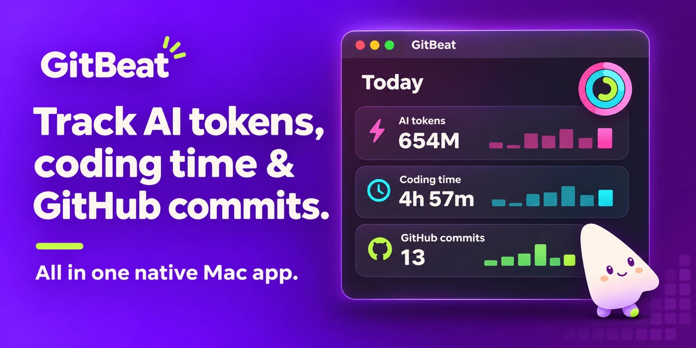

# GitBeat



[](LICENSE) · Name, logo and mascot reserved — see [`NOTICE`](NOTICE)

**Your coding rhythm, at a glance.** GitBeat is a native Mac app that turns the work you already do with AI coding tools and on GitHub into goal rings, streaks and charts — all on your Mac, nothing in the cloud.

```bash
scripts/build-app.sh --install
```

---

## What is GitBeat for?

If you code with AI, your effort is scattered across tool logs you never look at and a GitHub history that hides private work. GitBeat gathers it into one honest picture of your day: how much you leaned on AI, how long you actually coded, and what landed on GitHub. It's a quiet companion in your menu bar — a way to see your momentum, keep a streak going, and own a permanent record of your own activity.

It is **not** a leaderboard and it sends nothing anywhere. It's for you.

## What it tracks

GitBeat reads the files your tools already keep on your Mac and turns them into six views:

- **Summary** — today's three rings (AI tokens, coding time, GitHub commits), your streak this week, and weekly charts at a glance.
- **Tokens** — tokens per day across **Claude Code, OpenCode, Codex CLI and Gemini CLI**, broken down by tool and model, over the week, month or year. Includes an **equivalent API cost** so you can see the scale of your usage (on a subscription you don't pay per token — the number just gives it a size). Cost can be shown in **US dollars or Brazilian reais**.
- **GitHub** — commits and PRs per day, read from **each repository's own history**, so your **private repositories count** even when your public profile calendar hides them.
- **Time** — active coding time per day and your peak hours, measured from the gaps between sessions.
- **Goals** — set daily goals (tokens, coding time, commits) and track them. Defaults are **400M tokens, 4 hours, 3 commits**, all adjustable.
- **About** — what's on this Mac and where the numbers come from.

Alongside the window, a **menu bar item** carries an **animated mascot** that reacts to your activity — focused while you work, celebrating when you close your rings, resting when you step away — plus today's total at a glance.

## Why you'll want it

- **See your real rhythm** — one glance tells you whether today had momentum, without opening four tools.
- **Keep the history AI tools throw away** — Claude Code deletes conversations after 30 days. GitBeat keeps a **permanent copy of the numbers** (never the text) on your Mac and in your iCloud Drive, so your record outlives the tools.
- **Count your private work** — commits are read per repository, so closed-source and work repos finally show up.
- **Understand the cost scale** of your AI usage, in your own currency.
- **Stay motivated** — rings, streaks and a mascot that cheers you on.
- **Keep everything private** — it's a local app, not a service.

## Private by design

- GitBeat only reads **numbers** — time, project, model, token counts. **Conversation text is never stored or sent.**
- **Nothing leaves your Mac** except the GitHub CLI's own calls to GitHub and the copy in **your** iCloud Drive. There are no servers, no accounts, no analytics, no trackers.
- The permanent history stores only numbers, one file per month per Mac.

## Install

No Xcode needed — GitBeat builds with Apple's free Command Line Tools.

1. **Get the tools** (once):
   ```bash
   xcode-select --install
   ```
2. **Get the code:**
   ```bash
   git clone https://github.com/jasonmello/gitbeat.git && cd gitbeat
   ```
3. **Build and install** (the first build takes a couple of minutes; the app lands in your Applications folder):
   ```bash
   scripts/build-app.sh --install
   ```
4. **For GitHub data,** sign in the GitHub CLI once:
   ```bash
   gh auth login
   ```

Open GitBeat, and it lives in your menu bar. Change the language or goals in **Settings (⌘,)**.

## Requirements

- macOS 14 or newer.
- Apple Command Line Tools (`xcode-select --install`). Xcode itself is only useful if you want to edit the code with previews and a debugger.
- The GitHub CLI (`gh`) signed in, for the GitHub view.

## Good to know

- **Languages:** English (original) and Portuguese, switchable in Settings.
- **Look:** Liquid Glass on macOS 26+, with a Classic style as fallback; light and dark.
- **System:** opens at login and can remind you about rings and streaks — all optional, all in Settings.
- **Currency:** cost in reais uses an exchange rate **you** enter in Settings; the app never fetches a rate online (that would be a network call, and GitBeat makes none beyond `gh` and iCloud).

For contributors, the project map is [`AGENTS.md`](AGENTS.md) and the design rules are in [`DESIGN.md`](DESIGN.md). See [`CONTRIBUTING.md`](CONTRIBUTING.md).

---

## Português

**O seu ritmo de programação, num relance.** O GitBeat é um app nativo de Mac que transforma o trabalho que você já faz com ferramentas de IA e no GitHub em anéis de meta, sequências e gráficos — tudo no seu Mac, nada na nuvem.

```bash
scripts/build-app.sh --install
```

### Para que serve o GitBeat?

Se você programa com IA, o seu esforço fica espalhado em logs de ferramentas que você nunca abre e num histórico do GitHub que esconde o trabalho privado. O GitBeat junta isso tudo num retrato honesto do seu dia: o quanto você usou a IA, quanto tempo de fato programou e o que entrou no GitHub. É um companheiro discreto na barra de menu — um jeito de ver o seu embalo, manter uma sequência e ter um registro permanente da sua própria atividade.

**Não** é um ranking e não envia nada para lugar nenhum. É seu.

### O que ele acompanha

O GitBeat lê os arquivos que as suas ferramentas já guardam no Mac e os transforma em seis telas:

- **Resumo** — os três anéis de hoje (tokens de IA, tempo de código, commits no GitHub), a sua sequência na semana e os gráficos semanais, num relance.
- **Tokens** — tokens por dia no **Claude Code, OpenCode, Codex CLI e Gemini CLI**, separados por ferramenta e por modelo, na semana, no mês ou no ano. Inclui um **custo equivalente ao de API** para você ver a escala do uso (na assinatura você não paga por token — o número só dá o tamanho dele). O custo pode aparecer em **dólar ou em real**.
- **GitHub** — commits e PRs por dia, lidos do **histórico de cada repositório**, então os seus **repositórios privados contam**, mesmo quando o calendário público do seu perfil os esconde.
- **Time (Tempo)** — tempo ativo de programação por dia e os seus horários de pico, medidos pelos intervalos entre as sessões.
- **Goals (Metas)** — defina metas diárias (tokens, tempo de código, commits) e acompanhe. O padrão é **400 mi de tokens, 4 horas e 3 commits**, tudo ajustável.
- **About (Sobre)** — o que há neste Mac e de onde vêm os números.

Ao lado da janela, um **item na barra de menu** traz um **mascote animado** que reage à sua atividade — concentrado enquanto você trabalha, comemorando quando você fecha os anéis, descansando quando você se afasta — além do total de hoje num olhar.

### Por que você vai querer

- **Ver o seu ritmo real** — um olhar já diz se o dia teve embalo, sem abrir quatro ferramentas.
- **Guardar o histórico que as ferramentas de IA jogam fora** — o Claude Code apaga as conversas depois de 30 dias. O GitBeat mantém uma **cópia permanente dos números** (nunca do texto) no seu Mac e no seu iCloud Drive, então o seu registro sobrevive às ferramentas.
- **Contar o seu trabalho privado** — os commits são lidos por repositório, então os repositórios fechados e de trabalho enfim aparecem.
- **Entender a escala do custo** do seu uso de IA, na sua moeda.
- **Manter a motivação** — anéis, sequências e um mascote que torce por você.
- **Manter tudo privado** — é um app local, não um serviço.

### Privado por princípio

- O GitBeat lê só **números** — tempo, projeto, modelo, contagem de tokens. **O texto das conversas nunca é guardado nem enviado.**
- **Nada sai do seu Mac** além das chamadas do próprio GitHub CLI ao GitHub e da cópia no **seu** iCloud Drive. Não há servidor, conta, analytics nem rastreador.
- O histórico permanente guarda só números, um arquivo por mês por Mac.

### Instalação

Não precisa do Xcode — o GitBeat compila com as Command Line Tools gratuitas da Apple.

1. **Instale as ferramentas** (uma vez):
   ```bash
   xcode-select --install
   ```
2. **Pegue o código:**
   ```bash
   git clone https://github.com/jasonmello/gitbeat.git && cd gitbeat
   ```
3. **Compile e instale** (a primeira compilação leva uns minutos; o app vai para a pasta Aplicativos):
   ```bash
   scripts/build-app.sh --install
   ```
4. **Para os dados do GitHub,** entre uma vez no GitHub CLI:
   ```bash
   gh auth login
   ```

Abra o GitBeat e ele passa a viver na sua barra de menu. Troque o idioma ou as metas em **Ajustes (⌘,)**.

### Requisitos

- macOS 14 ou mais novo.
- Command Line Tools da Apple (`xcode-select --install`). O Xcode em si só serve se você quiser mexer no código com preview e depurador.
- O GitHub CLI (`gh`) logado, para a tela do GitHub.

### Bom saber

- **Idiomas:** inglês (original) e português, alternáveis em Ajustes.
- **Visual:** Liquid Glass no macOS 26+, com um estilo Clássico como alternativa; claro e escuro.
- **Sistema:** abre no login e pode lembrar você das metas e das sequências — tudo opcional, tudo em Ajustes.
- **Moeda:** o custo em real usa uma cotação que **você** informa em Ajustes; o app nunca busca cotação na internet (seria uma chamada de rede, e o GitBeat não faz nenhuma além do `gh` e do iCloud).

Para quem contribui, o mapa do projeto é o [`AGENTS.md`](AGENTS.md) e as regras de design estão no [`DESIGN.md`](DESIGN.md). Veja o [`CONTRIBUTING.md`](CONTRIBUTING.md).

---

## License · Licença

GitBeat is free software under the **GNU General Public License v3** ([`LICENSE`](LICENSE)), with one additional term: if you distribute GitBeat or a version based on it, you must keep the attribution **"Based on GitBeat by Jason Mello (github.com/jasonmello)"** in the About screen and the README. Contributions and modified versions stay under the GPL. The **name "GitBeat", the logo and the mascot are not part of the license** — they remain © 2026 Jason Mello, all rights reserved. A fork must use a different name and replace the logo and mascot. Full terms in [`NOTICE`](NOTICE).

**Português:** o GitBeat é software livre sob a **GNU General Public License v3** ([`LICENSE`](LICENSE)), com um termo a mais: ao distribuir o GitBeat ou uma versão baseada nele, você precisa manter a atribuição **"Baseado no GitBeat, de Jason Mello (github.com/jasonmello)"** na tela Sobre e no README. Contribuições e versões modificadas continuam sob a GPL. O **nome "GitBeat", o logo e o mascote não entram na licença** — continuam © 2026 Jason Mello, todos os direitos reservados. Um fork precisa usar outro nome e trocar o logo e o mascote. Termos completos no [`NOTICE`](NOTICE).

Proudly developed by · Orgulhosamente desenvolvido por [Jason Mello](https://github.com/jasonmello).
